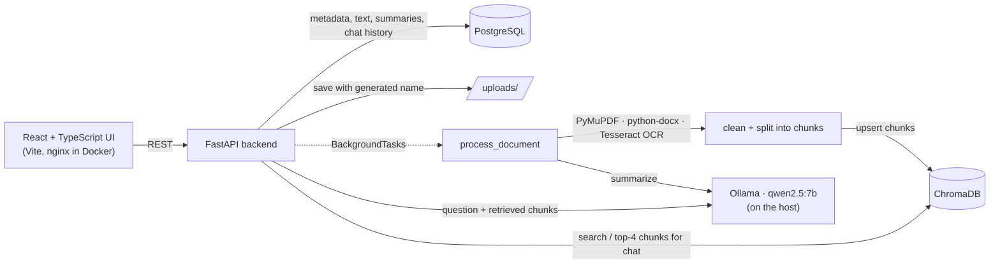

# DocuLens

[](https://github.com/ouhaibisaif/ai-document-intelligence/actions/workflows/tests.yml) 


**Upload a PDF, Word file or scanned image. DocuLens extracts the text, summarizes it, makes it searchable, and lets you chat with it, with the source snippets behind every answer.**

- **Local-first, no paid APIs.** The LLM is `qwen2.5:7b` running in Ollama on your machine. Documents never leave it.
- **A real RAG pipeline, end to end.** Extraction (PyMuPDF, python-docx, Tesseract OCR) → chunking → ChromaDB → retrieval → grounded answer with sources. Processing runs as a background task with `processing` / `completed` / `failed` status.
- **Built like an app, not a notebook.** FastAPI + SQLAlchemy + Alembic + PostgreSQL behind a React/TypeScript UI, with upload validation, rate limiting and explicit CORS.

**Run it** (Ollama on the host, then Docker for the rest):

```bash
ollama pull qwen2.5:7b && ollama serve
docker compose up --build   # UI http://localhost:8080 · API docs http://localhost:8000/docs
```

At work I ship the same pattern with Django REST + Angular on Azure.

## Features

- Upload PDF, DOCX, PNG, JPG, and JPEG files
- Extract text from PDFs, Word documents, and images
- Store document metadata and chat history in PostgreSQL
- Store searchable document chunks in ChromaDB
- Generate summaries with `qwen2.5:7b`
- Search inside uploaded documents
- Chat with a selected document
- Show source snippets for chat answers
- Track document status: `processing`, `completed`, `failed`
- Delete documents and indexed chunks
- Basic upload validation, rate limiting, and CORS configuration

## Tech Stack

Backend: Python, FastAPI, SQLAlchemy, Alembic, PostgreSQL, ChromaDB, PyMuPDF, python-docx, Pillow, pytesseract, Ollama.

Frontend: React, TypeScript, Vite, React Router, lucide-react.

AI: Ollama with the default model `qwen2.5:7b`.

## Architecture



Details in [docs/architecture.md](docs/architecture.md).

## Installation Without Docker

### 1. Start PostgreSQL and ChromaDB

Create a PostgreSQL database named `documents`. Start ChromaDB locally or let the backend use its local persistent `.chroma` directory by leaving `CHROMA_HOST` empty.

### 2. Set up Ollama and Qwen

```bash
ollama pull qwen2.5:7b
ollama serve
```

### 3. Set up the backend

```bash
cd backend
python -m venv .venv
source .venv/bin/activate
pip install -r requirements.txt
cp .env.example .env
alembic upgrade head
uvicorn app.main:app --reload
```

The backend runs at `http://localhost:8000`.

### 4. Set up the frontend

```bash
cd frontend
npm install
npm run dev
```

The frontend runs at `http://localhost:5173`.

## Installation With Docker

Make sure Ollama is running on the host machine and the Qwen model is available:

```bash
ollama pull qwen2.5:7b
ollama serve
```

Then start the application:

```bash
docker compose up --build
```

Frontend: `http://localhost:8080`

Backend: `http://localhost:8000`

ChromaDB: `http://localhost:8001`

## Environment Variables

The backend environment variables are documented in `backend/.env.example`.

Key values:

- `DATABASE_URL`
- `CORS_ORIGINS`
- `UPLOAD_DIR`
- `MAX_UPLOAD_BYTES`
- `CHROMA_HOST`
- `CHROMA_PORT`
- `OLLAMA_BASE_URL`
- `OLLAMA_MODEL`
- `REQUEST_LIMIT_PER_MINUTE`

## API Documentation

FastAPI provides OpenAPI docs at:

```text
http://localhost:8000/docs
```

Main endpoints:

- `GET /health`
- `POST /documents/upload`
- `GET /documents`
- `GET /documents/{document_id}`
- `DELETE /documents/{document_id}`
- `GET /documents/{document_id}/summary`
- `POST /documents/{document_id}/chat`
- `GET /documents/search?q=...`

## Example Usage

1. Upload a document from the Upload page.
2. Wait for the status to become `completed`.
3. Open the document detail page to read the summary and extracted text.
4. Ask a question in the chat panel.
5. Review the source snippets returned with the answer.

## Security Notes

- Uploaded filenames are never trusted.
- Files are saved with generated unique names.
- Only PDF, DOCX, PNG, JPG, and JPEG MIME types are accepted.
- Upload size is limited by `MAX_UPLOAD_BYTES`.
- File system paths are not exposed through API responses.
- `.env` is ignored by Git; only `.env.example` is committed.
- CORS origins are configured explicitly.
- A simple in-memory rate limiter protects basic local usage.
- The document chat prompt tells the model to ignore prompt injection inside documents and user messages.

## Known Limitations

- OCR depends on Tesseract being installed locally.
- The default hash embeddings are simple and local; swap in a stronger local embedding model for production-grade retrieval.
- Background processing runs in the FastAPI process for this first version.
- Docker Compose connects to Ollama on the host through `host.docker.internal`, which may need adjustment on Linux.

## Future Improvements

- Add authentication
- Add document tags and collections
- Add streaming chat responses
- Add better local embedding models
- Add tests and CI
- Add retryable background jobs with a queue
